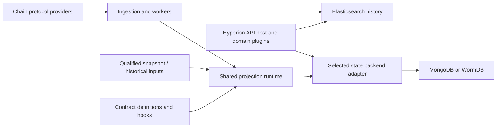

# Hyperion 4.5 architecture definition

Status: Working architecture draft, based on operator-approved decisions through 2026-10-20 UTC.

Start here. This document defines the system boundaries, release obligations, and operator workflows
that implementation agents follow. The [detailed decision record](hyperion-4.5-decisions.md) and
[ADRs](../adr/) preserve accepted constraints and rationale. Open implementation details are not
additional release requirements or settled architectural choices.

## Scope and release requirements

This is the 4.5 release of Hyperion History API. Most development happens in hyperion-tools, with
substantial indexer/API changes in hyperion-history-api and database work in WormDB as needed.
Repository homes and release coordination are recorded in the [approved roadmap](../roadmap/hyperion-4.5.md).
The [component foundation](hyperion-4.5-component-homes.md) assigns initial package/source homes
and separates the new SDK metadata contract from legacy plugin migration.

The release must deliver:

- An upgrade that keeps existing Elasticsearch history usable without a full history reindex.
  New or changed state projections initialize or rebuild separately.
- Full AtomicAssets and AtomicMarket API parity against atomicassets/atomicassets-api 2.7.0,
  pinned to commit 0aabc47dcf8bd0804d4dcecb336c90fc02a9c89e.
- Reversible-head state serving by default, with correct fork rollback, plus an optional
  irreversible-only mode per chain.
- Live reload of declarative contract mappings. Hooks and native protocol components may use
  controlled restarts.
- Working Wire protocol-extension support, qualified against the new testnet to be launched
  with Wire's contracts. The launch's node, contract, and extension revisions must be pinned.

MongoDB and WormDB are permanent state-backend alternatives. A MongoDB-only 4.5 launch is permitted
if the WormDB effort is too high; this does not waive the other requirements. Any backend offered as
supported must satisfy the applicable API, capability, finality, and recovery contracts.

These are architecture requirements, not claims that implementation or qualification is complete.

## Components and responsibilities

The following diagram shows logical responsibilities; it does not prescribe process placement.

| Component | Owns |
|---|---|
| Shared Hyperion runtime | Ingestion coordination, projection execution, durable progress, initialization/rebuild jobs, activation/readiness, and fork-recovery coordination. |
| Chain protocol extensions | Chain-specific binary/ABI conventions, codecs, keys, timestamps, and normalization before contract processing. Required Node/Rust components form one operator-managed package. |
| Contract-indexing plugins | Declarative projections, required inputs/capabilities, dependencies, indexes, and domain transformations. Complex cases use hooks; the default is JavaScript with TypeScript authoring through the SDK. |
| Backend adapters | Native storage/query execution, capability implementation, durable application, and rollback of stored projection effects. Adapter versions are independent of database-engine versions. |
| API domain plugins | Domain routes and compatible public responses through the existing Fastify API host and shared query interfaces. AtomicAssets and AtomicMarket form one operator-facing plugin with modular internals. |

RabbitMQ remains the default ingestion transport for 4.5. Select protocol providers before decoding
the affected data, with coordinated semantics across the applicable Node/Rust paths.

Keep core generic. Contract semantics belong to plugins; native database operations belong to
adapters. The same contract definitions and plugin queries must work with MongoDB and WormDB
without contract-specific changes to Hyperion core. Protocol, backend, and native components retain
their own implementation-language choices.

Build on the existing worker infrastructure and tools. New pools, services, or process boundaries
need justification against the accepted isolation, recovery, and throughput requirements.

## State, history, and portable interfaces

Operators select **one active state backend per chain**, shared by all enabled state API domains.

Elasticsearch remains the history tier. The selected state backend may hold explicitly owned,
rebuildable history-derived fields or indexes needed for correct filtering, sorting, counts, and
pagination; lifecycle history remains in the history/archive tiers.

Plugins produce backend-neutral logical mutations and structured logical queries. The runtime
manages mutation application, progress, and recovery through the adapter. Definitions explicitly
declare atomic groups where multiple records must commit together; ordinary batches are not
automatically multi-record transactions. Validate required backend capabilities before activation.

State and history progress independently. Endpoint contracts may require coordination, but there
is no global same-block read barrier. Snapshot consistency is declared per endpoint.

Hyperion 4.5 returns uint64 sequence identifiers as exact canonical decimal strings on every chain,
including Antelope and Wire. Queries, aliases, caches, streams and archive exchanges preserve those
identities. This is an intentional public type change; client migration and retained-history query
qualification are required. See [ADR 0053](../adr/0053-use-lossless-sequence-strings-on-all-chains.md).

## Contract configuration and lifecycle

Configuration should be simple for operators. In full auto-map mode, operators allow contract
accounts and Hyperion discovers and maintains ABI-derived mappings within that scope. Automatic
index selection should use sensible defaults and retain manual overrides.

Mappings bind to the applicable on-chain ABI deployment and have independent immutable mapping
revisions. Historical processing uses the applicable deployment and revision.

Validate declarative changes before activation. When rebuilding is needed, keep the previous
compatible projection serving and current while preparing, catching up, and validating its
replacement. An incompatible ABI cannot be processed using a mapping that does not support it.
New projections become ready only after initialization requirements are satisfied.

Each projection declares supported initialization strategies and required source coverage.
Snapshots plus catch-up and historical backfill satisfy different needs. Hyperion verifies coverage
and owns job scheduling, checkpoints, retry/resume, and readiness; plugins supply requirements and
domain logic. Replay determinism is a design target where feasible, with SDK/enforcement details
still to qualify.

Enabling a plugin resolves required indexing dependencies within configured contract scope.
Dependency activation does not automatically expose another plugin's public APIs.

## Correctness and availability

- **Contract issues never halt chain indexing.** Isolate affected projections and dependents,
  track incomplete progress, and continue unrelated work.
- Use a configurable bounded local recovery window, with historical sources for older inputs.
  Unavailable required data leaves the projection incomplete; do not silently skip gaps.
- Use at-least-once delivery and idempotent processing. Acknowledge work only after durable effects
  and recoverable progress. Preserve order per projection by default; allow explicitly independent
  partitions in parallel. Historical bulk strategies must preserve equivalent logical results.
- The runtime coordinates fork recovery and adapters implement rollback. Pause affected queries
  until a consistent canonical view is ready; return a retryable unavailable error when recovery
  exceeds the request timeout. Known orphaned state must not be served.
- A failed required projection makes affected queries retryably unavailable by default. A plugin
  may explicitly support a preserved last-valid view. Its responses identify the actual served
  view's completeness block and last-valid-state mode through shared HTTP headers, preserving
  compatible JSON bodies and matching cached metadata.
- Bind state requests and cached results to compatible backend/projection versions across
  cutovers. Invalid contexts produce appropriate retryable errors. Per-endpoint snapshot policy
  and independent state/history progress still apply.
- Give live indexing priority under contention. Preserve infrastructure backpressure: pause the
  shared reader when Elasticsearch exhausts its queue budget and resume after it drains.
  Contract-specific failures must remain isolated from that shared pipeline.

## Releases, trust, and operator changes

Plugins, backend adapter extensions, and the shared SDK version independently of Hyperion core.
Each Hyperion release pins tested compatible component versions so operators do not have to manage
compatibility matching. The SDK stays backward compatible within each major; breaking contract
changes require a new major.

Standard 4.5 distributions include the pinned AtomicAssets plugin, including AtomicMarket, disabled
by default and enabled per chain. A chain extension such as Wire coordinates its required Node/Rust
pieces as one operator package.

Executable plugins are trusted code: operators audit the plugins they choose to use. Compatibility
checks, shared interfaces, and failure isolation still apply. Executable upgrades are
operator-initiated. EOS Rio provides an official catalog repository with compatibility declarations;
catalog changes do not automatically replace running code.

Backend changes initialize, catch up, and validate the destination before operator cutover. A brief
pause of that chain's state API is acceptable. All state domains switch to the selected backend,
while existing Elasticsearch history remains usable.

Transport-interface extraction and untrusted-plugin sandboxing are follow-up work. A zero-downtime
backend cutover is not an additional 4.5 requirement.

## Remaining scope and engineering work

Keep the remaining architecture discussion focused on:

- The final API-family and chain/contract support matrix beyond the accepted AtomicAssets/AtomicMarket
  parity obligation.
- The exact Wire testnet launch profile and qualification scope.
- Cross-repository ownership, delivery milestones, and backend qualification/release decisions.

Component designs will define operation/type schemas, checkpoint identities, codec bindings,
physical storage/compaction, read-context handles, header names, resource defaults, and tooling.
Those choices should follow the accepted boundaries and be reviewed with implementation evidence.
Changes to release scope, public behavior, or component ownership return to architecture discussion.

## References

- [SDK, runtime and adapter source homes](hyperion-4.5-component-homes.md)
- [Approved development roadmap and repository ownership](../roadmap/hyperion-4.5.md)
- [Approved initial issue batch](../roadmap/hyperion-4.5-initial-issues.md)
- [Detailed decisions and their status](hyperion-4.5-decisions.md)
- [Architecture decision records](../adr/)
- [Domain glossary](../../CONTEXT.md)
- [Existing MongoDB implementation baseline](hyperion-4.5-existing-mongodb.md)
- [Wire protocol investigation and qualification limits](hyperion-4.5-wire-protocol.md)
